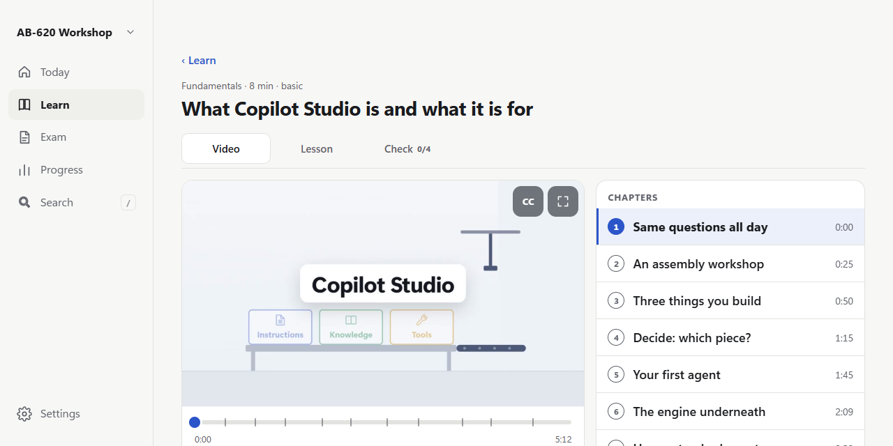
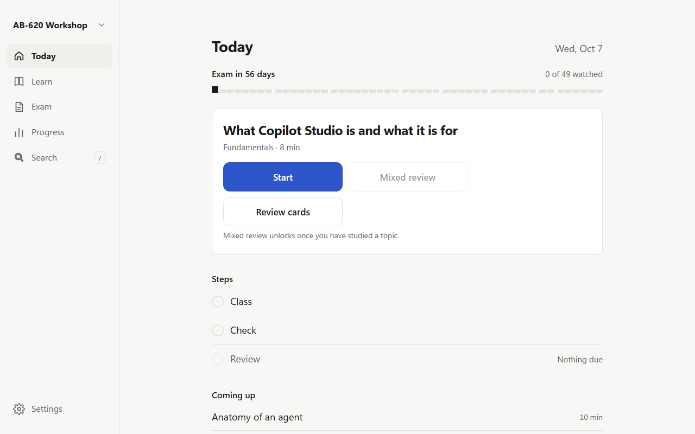
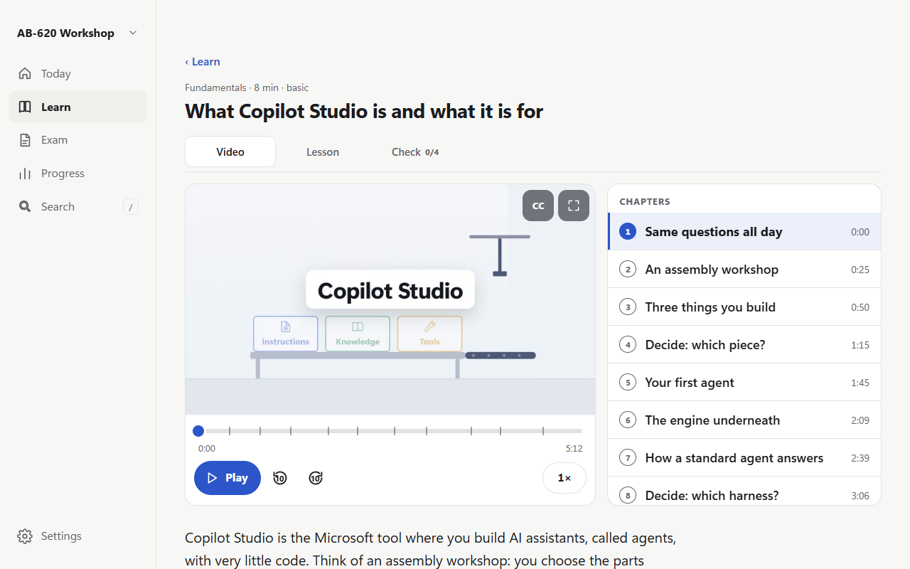
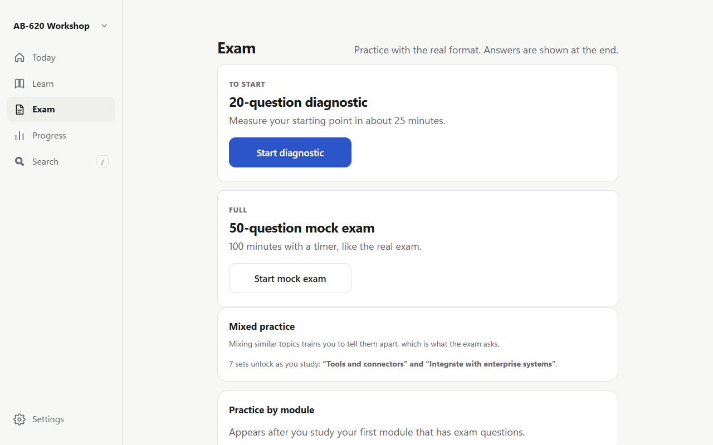
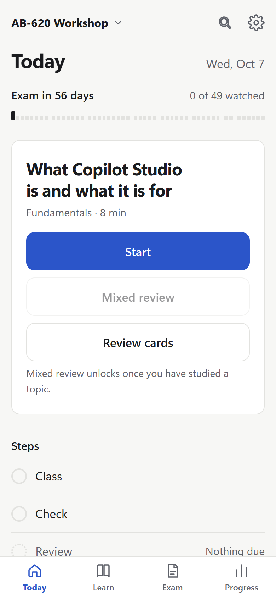
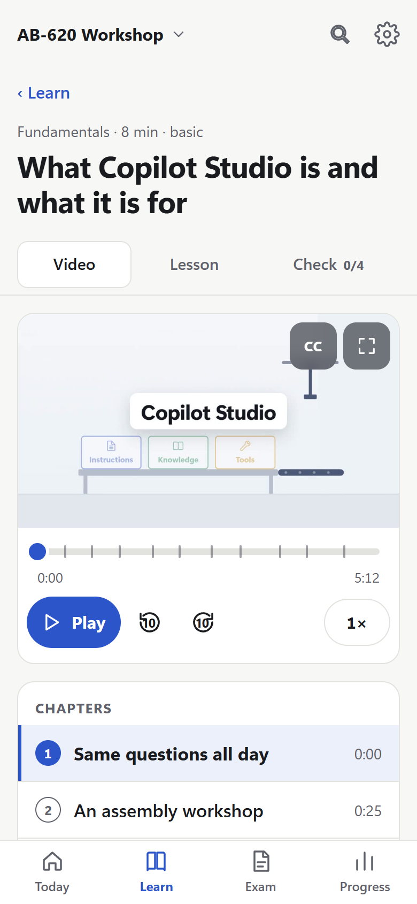
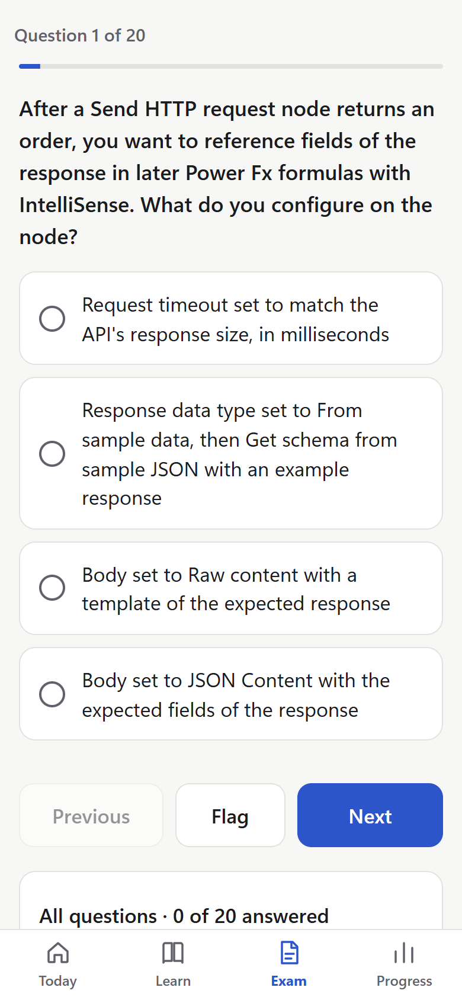

# AB-620 & AB-400 Study Workshop

**Pass the Microsoft Copilot Studio exam by watching and doing: 55 lessons, 335 original practice questions, 296 flashcards and spaced repetition, free and open source.**

[](https://omirarevalo-lab.github.io/ab620-copilot-studio/)
[](https://www.youtube.com/playlist?list=PLFCvw7ihXKJU)
[](LICENSE)
[](LICENSE-CONTENT)
[](CONTRIBUTING.md)



A study app for the **AB-620** exam (Copilot Studio: AI Agent Builder Associate) and the **AB-400** exam (Power Platform with code and AI). It is built for a beginner who learns by watching and doing, and who does not want to be sent off to read documentation. No account, no tracking: your progress stays in your browser.

## Try it in your browser

**[Open the live demo](https://omirarevalo-lab.github.io/ab620-copilot-studio/)**: the whole app, free, nothing to install. It works on a phone and has a dark theme.

## Watch the lessons

Each class is a short narrated video (about 5 to 9 minutes) with a story, a mental model and three or four "Decide" pauses, where you answer an exam-style question before the narrator does.

- **[Channel](https://www.youtube.com/@CertLabClasses)**
- **[Playlist](https://www.youtube.com/playlist?list=PLFCvw7ihXKJU)**

34 class videos are finished so far; more are on the way. On the demo site, lessons whose video is not on YouTube yet show a "Video coming soon" card and your device's voice reads the class aloud; the checks and practice questions work for every topic.

## What is inside

| | AB-620 | AB-400 |
|---|---:|---:|
| Lessons (topics) | 49 | 6 |
| Original practice questions (single and multiple answer) | 300 | 35 |
| Flashcards (one fact per card) | 262 | 34 |
| Skills from the official skills outline | 44 | 65 |

Both exams live in one app with **separate progress**.

- **Daily plan**: "Today" tells you the next class, the check and the review, counting down to your exam date.
- **Video classes** with chapters, captions, speed control, full screen and in-video exam questions.
- **Check** after each class, then **practice** by skill, and a timed **exam simulator**.
- **"Watch the explanation"**: a wrong answer links to the exact video chapter that covers it.
- **Spaced repetition** with [FSRS](https://github.com/open-spaced-repetition/ts-fsrs) (`ts-fsrs`) to schedule your reviews.
- **Search** across lessons, questions, cards and the words spoken in the videos, plus a glossary.
- **Offline-first**: one self-contained HTML file, progress saved in your browser.

Questions are original and written from public Microsoft documentation, with a source link on every explanation. They are **not exam dumps**.

## Screenshots

| Today | Class | Exam |
|---|---|---|
|  |  |  |

| Phone: Today | Phone: Class | Phone: Question |
|---|---|---|
|  |  |  |

## How the videos are made

The class videos are code. There is no screen recorder and no timeline editor: every video is an HTML file that is rendered to MP4, so it can be diffed, linted and rebuilt.

1. **Script**: a long class script in JSON (`research/video-long/<id>-script.json`): hook, mental model, examples, "Decide" pauses, callback close.
2. **Narration**: [Kokoro-82M](https://huggingface.co/hexgrad/Kokoro-82M) text-to-speech running locally through `kokoro-onnx` (`tools/video/narrate.py`). It writes `narration.mp3` and `beats.json` with the timing of every sentence.
3. **Storyboard**: scenes, camera moves and on-screen cards, written down per class (`research/video-long/<id>-storyboard.md`) and in `video/<id>/scenes.json`.
4. **Composition**: `video/<id>/composition.html`, an HTML page animated with [GSAP](https://gsap.com), using the scene kit in `tools/video/kit.mjs` and the Fluent icons and styles in `video/assets/`.
5. **Layout lint**: `tools/video/lint-layout.mjs` checks overlaps, overflow and text that leaves the frame, so a bad layout fails before rendering.
6. **Render**: [HyperFrames](https://github.com/heygen-com/hyperframes) renders the page frame by frame and `ffmpeg` muxes the audio (`tools/video/render.mjs`). `tools/video/deliver.mjs` produces the final 1080p file at -16 LUFS with captions of two lines at most.

The video sources are in `video/<id>/`; the MP4 files are not in the repo (they are on YouTube).

## Quick start

You need [Node.js](https://nodejs.org) 20 or newer.

```bash
npm install
node build.mjs            # writes dist/taller-ab620.html (one self-contained file)
node tools/serve.mjs      # http://localhost:4620
```

Useful checks:

```bash
node tools/validate-course.mjs   # lesson data against the schema
node tools/smoke.mjs             # data and build smoke test
npx playwright test              # end-to-end tests (Microsoft Edge)
node tools/digest.mjs count      # numbers, without opening the big data files
```

`node tools/serve.mjs` serves the lesson MP4s from `video/<id>/<id>.mp4` when you have them locally. Rendering videos also needs Python with `kokoro-onnx` and `soundfile`, the Kokoro model files, `ffmpeg` and GSAP (see [THIRD-PARTY-NOTICES.md](THIRD-PARTY-NOTICES.md)).

**Getting GSAP for the render step.** GSAP is not included in this repo. Run `npm install gsap` and copy `node_modules/gsap/dist/gsap.min.js`, or download it from the CDN (`https://cdn.jsdelivr.net/npm/gsap@3/dist/gsap.min.js`), to the path that the `GSAP` constant in `tools/video/render.mjs` points to (line 22). Free under the [GSAP Standard "No Charge" License](https://gsap.com/standard-license).

## Repository layout

```
src/                 the app: index.html, app.js, styles.css, search, FSRS (vendor/)
data/                AB-620 content: course-m*.js (lessons), questions.js, flashcards.js, meta.js (skills)
data/ab400/          the same for AB-400
audio/               narration MP3 + timing JSON per lesson
video/assets/        shared video styles, animation helpers, Fluent icons
video/<id>/          video sources: composition.html, scenes.json, beats.json, quiz.json
research/video-long/ class scripts, storyboards and card lists
tools/               build, validators, search/question tools, video pipeline (tools/video)
tests/e2e/           Playwright end-to-end tests
docs/                the GitHub Pages demo (the built app, audio, screenshots)
build.mjs            inlines CSS, JS and data into dist/taller-ab620.html
```

## Contributing

Fixes, new questions and corrections with a source link are very welcome. Read [CONTRIBUTING.md](CONTRIBUTING.md); it has a list of good first issues.

## Disclaimer

This is an independent, unofficial study aid. It is **not affiliated with, endorsed by or sponsored by Microsoft**. Microsoft, Copilot Studio, Power Platform, Azure, Teams, Dataverse and other names are trademarks of their respective owners. All practice questions are original; none are taken from the real exams, and this project does not guarantee a pass. Always check the official [exam page](https://learn.microsoft.com/credentials/) and [Microsoft Learn](https://learn.microsoft.com/) for the current skills outline, because Copilot Studio changes fast.

## License

- **Code**: [MIT](LICENSE).
- **Content** (lessons, questions, flashcards, audio, video sources and videos): [CC BY 4.0](LICENSE-CONTENT).
- Third-party components: [THIRD-PARTY-NOTICES.md](THIRD-PARTY-NOTICES.md).

If this helps you, a star on the repo helps other people find it.
